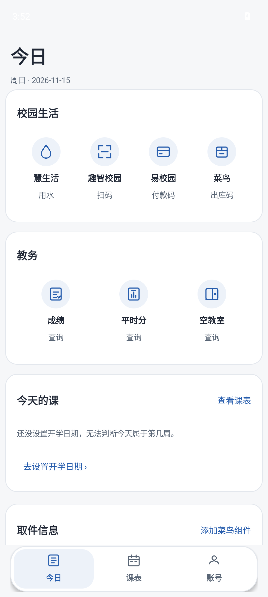
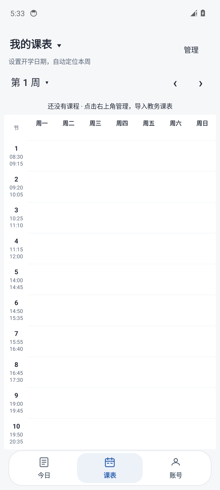
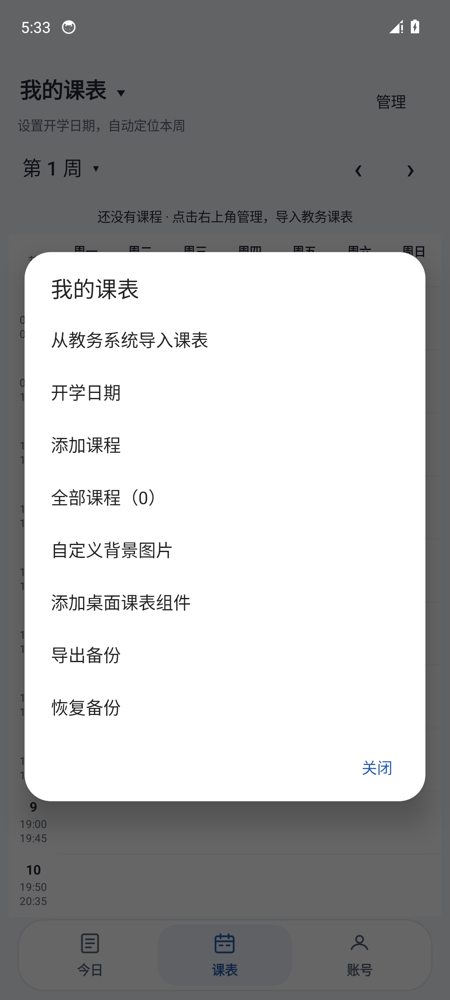
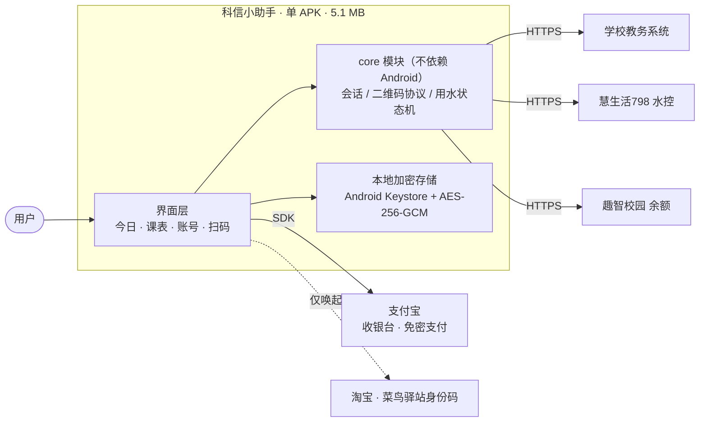
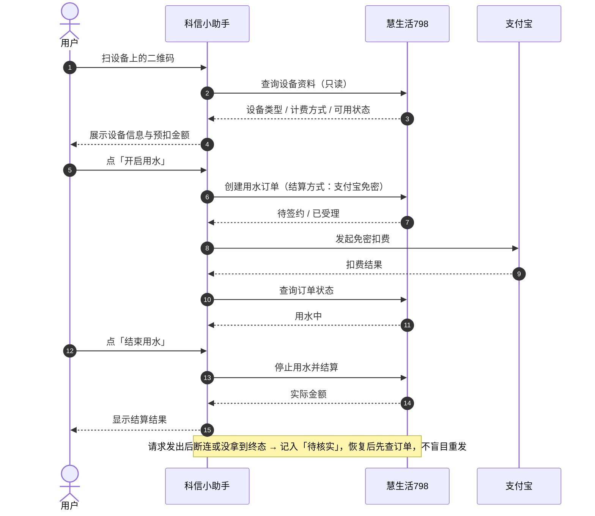

<div align="center">


<h1>科信小助手</h1>

<p><b>河北工程大学科信学院 · 趣智校园 / 慧生活798 的第三方安卓客户端</b></p>
<p>吃饭、接水、洗澡、看课表、取件码 —— 一个 APK，不用在多个应用之间来回跳。</p>

<p>
<a href="https://github.com/shynekoo/CampusKit/releases/latest"></a>
<a href="LICENSE"></a>
<a href="#系统要求"></a>
<a href="#下载"></a>
<a href="#为什么不使用-gradle"></a>
<a href="https://github.com/shynekoo/CampusKit/stargazers"></a>
</p>

<p>
<a href="#下载">下载</a> ·
<a href="#界面">界面</a> ·
<a href="#功能">功能</a> ·
<a href="#工作原理">工作原理</a> ·
<a href="#隐私与安全">隐私</a> ·
<a href="#从源码构建">构建</a> ·
<a href="#常见问题">常见问题</a> ·
<a href="#更新日志">更新日志</a>
</p>
</div>

---

## 这个项目是什么

学校的日常被拆在好几个 App 里：查课表要开教务系统，洗澡打水要开慧生活798（或它的支付宝小程序），看余额、扫码要开趣智校园，取快递要开淘宝进菜鸟驿站。每个都要登录、都有开屏、都有推送。

科信小助手把这些入口收进一个 5.1 MB 的原生应用：

- **不建账号系统**：没有注册、没有手机号绑定，登录凭据 AES-256-GCM 加密存在手机私有目录
- **不接中间服务器**：课表、成绩、水控全部直连学校与平台的官方接口
- **不做增值**：没有广告、没有推送 SDK、没有统计 SDK，权限只申请 4 个

## 项目一览

| 项目 | 情况 |
| :-- | :-- |
| 最新版本 | **v2.5.8**（2026-11-19） |
| 安装包 | 5,359,482 字节 · SHA-256 `33851ee1190e98b1655489bd1c7989119fc6f16cfc4fd7883dc3beae6b5728bc` |
| 系统要求 | Android 7.0（API 24）及以上，targetSdk 36 |
| 技术栈 | Java + 原生 View；无 Gradle、无第三方 UI 框架 |
| 第三方库 | ZXing 3.5.3、PDFBox-Android 2.0.27.0、Bouncy Castle 1.72、支付宝 SDK 15.8.42 |
| 代码量 | 约 1.5 万行 Java（110 个受版本管理的文件）+ 约 1000 行 Python 构建脚本 |
| 测试 | 出包流程内跑 1278 项核心断言，全过才生成 APK |

## 界面

| 今日 | 课表 | 课表 · 管理 |
| :--: | :--: | :--: |
|  |  |  |
| 校园生活入口、今天的课、教务查询、取件信息；没设开学日期就直接说怎么设 | 按节次排布的周视图，空表也把「怎么导入」写在页面上 | 多课表、教务导入、开学日期、添加课程、自定义背景、桌面组件、备份与恢复 |

## 功能

| 模块 | 你能做什么 | 实现要点 |
| :-- | :-- | :-- |
| **今日** | 一页汇总：慧生活 / 趣智校园 / 易校园 / 菜鸟四个入口，教务查询，今天的课，取件信息 | 首页只做跳转与汇总，本身不发敏感请求 |
| **课表** | 从教务系统导入（选学年学期即可），多课表管理、逐门编辑周次、自定义背景、导出 / 恢复备份 | 解析教务网页表格与 PDF 表格，导入后完全离线可用 |
| **桌面组件** | 小、中、宽三种尺寸的课表组件 | `AppWidgetProvider` 实现，课表变动后刷新 |
| **成绩 / 平时分 / 空教室** | 按学期、周次、节次查询，即查即出 | 直连学校教务接口，密码只在查询时提交 |
| **余额与充值** | 查余额；充值走支付宝官方收银台，返回后重新读余额 | 应用不接触支付凭据，钱只在支付宝里扣 |
| **洗澡 / 打水** | 扫设备码 → 「开启用水」→ 支付宝免密扣费 → 「结束用水」→ 结算 | 在线水控、淋浴、饮水机均支持；失败给出具体原因（欠费 / 被占用 / 未签约等） |
| **取件身份码** | 一键跳到淘宝 → 菜鸟驿站身份码 | 只做唤起与跳转，应用本身不访问取件数据 |
| **应用内更新** | 启动时检查版本清单，下载后校验字节数与 SHA-256 才安装 | 最后一步必须你点「安装」，应用不会静默装东西 |
| **意见反馈 / 更多** | 邮箱与 QQ 群（点一下复制）、仓库地址、内嵌 MIT 许可证全文 | 许可证弹窗离线可读 |
| **外观与主题** | 深色模式（自动 / 浅色 / 深色）、主题色、悬浮底栏、返回手势动画；课表配色、课程文字颜色、圆角、格子不透明度、网格线开关（默认关闭） | 颜色从一处静态调色板下发，换主题不需要第二套布局；偏好存在本机 |

## 工作原理

整个应用只有一个 APK，没有后端。所有调用都从手机直接发往官方服务器：



洗澡打水的完整链路长这样——每一步都有明确的失败出口，而不是「请稍候」：



## 隐私与安全

| 数据 | 存在哪 | 会离开手机吗 |
| :-- | :-- | :-- |
| 水控 / 教务登录凭据 | 应用私有目录，AES-256-GCM 加密，密钥由 Android Keystore 保护 | 不会，只在请求对应官方接口时使用 |
| 课表与设置 | 应用私有目录，且标记为不参与系统备份 | 只有你手动「导出备份」时才会生成文件 |
| 诊断信息 | 只记录白名单字段（不记账号、课程内容、请求正文），默认关闭，存在应用私有目录 | 不会自动离开手机；复制或导出由你决定 |
| 支付 | 交给支付宝 SDK 与官方收银台 | 不经过任何中间服务器 |

权限只申请这 4 个：

| 权限 | 用途 |
| :-- | :-- |
| `INTERNET` / `ACCESS_NETWORK_STATE` | 访问教务与慧生活接口；网络状态供支付宝 SDK 判断连通性（业务代码不读） |
| `CAMERA` | 扫设备上的二维码；不解码时不打开相机 |
| `REQUEST_INSTALL_PACKAGES` | 应用内更新把 APK 交给系统安装器，每次都要你确认 |

没有申请定位、通讯录、短信、存储、蓝牙——水控不需要蓝牙，扫码也不需要。

## 下载

1. 从 [Releases 最新版](https://github.com/shynekoo/CampusKit/releases/latest) 下载 `kexin-xiaozhushou-2.5.8.apk`（国内也可以用直链：<https://wbapp-g8yy3klci8kmeufm6vdn0h.app.workbuddy.host/campuskit-2.5.8.apk?sharecode=BZD63HRP4B>）
2. 允许浏览器「安装未知应用」，装完打开即可，不需要 Root、不需要任何框架
3. 想核对包有没有被改过：

```bash
sha256sum kexin-xiaozhushou-2.5.8.apk
# ac40b21dfad29e1c2f6e985bec8762ec5244ba31564b497e87f7001f4410d806
```

> ⚠️ **升级请覆盖安装。** 换成别的签名只能卸载重装，而卸载会清掉课表与凭据——先在「课表 → 管理 → 导出备份」存一份，重装后再恢复。

## 系统要求

| 项 | 要求 |
| :-- | :-- |
| 系统 | Android 7.0（API 24）及以上，targetSdk 36 |
| 学校 | 教务导入适配 **河北工程大学** 教务系统（网页表格 + 七列文字表格 PDF）；扫描版 PDF 会明确提示失败 |
| 水控 | 慧生活798 覆盖的在线水控、淋浴、饮水机；需要已开通支付宝免密 |
| 体积 / 网络 | 安装包 5.1 MB；除「今天的课」等本地功能外需要联网 |

## 从源码构建

手工工具链，没有 Gradle：

```bash
python scripts/bootstrap_android.py   # 下载 API 36 平台与 Build-Tools 到 tools/android-sdk
python scripts/test_core.py           # 只跑核心断言
python scripts/build_preview.py --field-water
```

`build_preview.py` 会先跑核心测试，再调用官方 `aapt2`、`d8`、`zipalign`、`apksigner` 出包：

- 产出 `delivery/科信小助手-<版本>.apk`（约 5.1 MB）与同名 `.build.json`（体积、SHA-256、逐文件源码哈希、权限清单）
- 1278 项核心断言全通过才会生成 APK

环境：JDK 24（生成 Java 8 字节码）、Python 3；当前在 Windows 上验证。

签名密钥 `tools/keys/preview.p12` 与其口令不进仓库：口令放 `tools/keys/keystore.pass`，或用环境变量 `QZXY_KS_PASS` 传入。证书 SHA-256 指纹 `13:B9:68:92:9F:5B:60:E5:CF:6B:5B:67:A5:13:16:78:AB:80:A3:6F:77:1C:07:DD:93:A9:62:4D:7E:BD:42:09`——换密钥会让已装用户无法覆盖安装，务必保留备份。

### 为什么不使用 Gradle

- 构建过程可逐行读完：下载什么、校验什么、打进去哪些文件，全在脚本里写死
- 依赖按 SHA-256 固定，第三方 AAR 是手工合并的（`classes.jar` → `javac`/`d8`，清单与资源抄进项目）
- 测试和出包是同一步，跑不过就出不来包

代价是只能按脚本构建，IDE 的「一键运行」不可用；加依赖也需要手工处理 AAR。

## 目录结构

```
client/
  android/      原生 Android 客户端：56 个 Activity/辅助类，无 Gradle
  core/         不依赖 Android 的会话、二维码协议、用水状态机
  androidTest/  核心断言的 JVM 侧测试
scripts/        构建、核心断言，以及抓包 / 反编译 / 真机核验辅助脚本
design-system/  界面规范与页面稿
delivery/       历次 APK、构建报告、发布说明
analysis/       协议分析、实测记录、实现路线
docs/           README 用到的截图
```

## 常见问题

<details>
<summary><b>需要 Root 或 LSPosed 之类的框架吗？</b></summary>

不需要。普通 APK，装完就能用。扫码、加解密、桌面组件都在应用内完成。
</details>

<details>
<summary><b>我的学校能用吗？</b></summary>

水控部分走慧生活798，只要你们学校用它就能试；教务导入目前只为河北工程大学教务系统写的（网页表格 + PDF 表格两种来源），换学校要改解析规则。欢迎提交 PR 或样例文件。
</details>

<details>
<summary><b>为什么要我输教务密码？会被上传吗？</b></summary>

查成绩、空教室、导课表都要过学校自己的登录。密码只在你的操作过程中提交给学校教务系统，不写入 App 的加密存储，也不经过任何第三方服务器。想更保险，可以只在需要时进「教务首页」手动登录。
</details>

<details>
<summary><b>升级会丢课表吗？</b></summary>

同签名覆盖安装不会。换签名、卸载重装会。所以升级前建议「导出备份」，新装后「恢复备份」。
</details>

<details>
<summary><b>更新是怎么装上的？会不会偷偷装？</b></summary>

启动时读版本清单，你确认后下载，校验字节数与 SHA-256 通过才交给系统安装器；最后的「安装」必须你自己点。
</details>

<details>
<summary><b>水控一直停在「待核实」怎么办？</b></summary>

先别重复点「开启用水」。待核实表示命令发出去了但没拿到终态（断网、进程被杀、服务器超时），应用会在恢复后先查订单状态。需要立刻确认时，去慧生活798 或支付宝账单里看这笔订单，以官方账单为准。
</details>

## 路线图

以下只是方向，没有时间表：

| 状态 | 事项 |
| :-- | :-- |
| ✅ 已完成 | 课表导入与编辑、三种桌面组件、成绩 / 平时分 / 空教室、余额查询、支付宝充值、扫码开启与结束用水、待核实恢复、应用内更新、MIT 开源 |
| 🚧 待办 | 扫描版 PDF 课表识别、更多学校教务适配、无障碍与字号适配细化 |
| 🚫 不做 | 广告、推送、账号代登录、任何形式的账单篡改 |

## 反馈与贡献

- **Bug / 功能建议**：提 [Issue](https://github.com/shynekoo/CampusKit/issues)，请带上手机型号、Android 版本、复现步骤；有诊断信息更好（导出时会自动脱敏）
- **应用内反馈**：账号 → 意见反馈，邮箱与 QQ 群点一下复制
- **代码贡献**：先开 Issue 说清楚要改什么，再提 PR；改动需通过 `python scripts/test_core.py`，涉及界面的请附截图

## 更新日志

**v2.5.8**（2026-11-19）

- 底栏和切页动画重做，页面切换更加丝滑
- 新增学业情况查询功能
- 新增趣智校园使用码
- 新增应用内更新日志

**v2.5.7**（2026-11-18）

- 新增深色主题与返回手势动画
- 应用与课表主题色支持自定义
- 修复了课表显示异常：课名字号与行高按屏幕自动适配，窄屏不再挤成两字一行，整块高度跟着页面剩余空间走

**v2.5.6.11**（2026-11-18）

- 账号页新增「外观与主题」：分应用主题与课表外观两页
- 应用主题：明暗模式（自动 / 浅色 / 深色）、主题色彩（默认 / 自定义）、悬浮底栏样式、返回手势动画
- 课表外观：课程配色（默认 / 自定义，18 个色槽逐个可调）、课程文字颜色、格子圆角、格子不透明度、显示网格线开关；改动在上面就能看到实时预览
- 深色是一套单独挑的灰阶，不是把浅色反相：正文、卡片、对话框、状态栏都跟着走

**v2.5.6**（2026-11-17）

- 修复慧生活798「进入独立用水」入口丢失：2.5.5 误用只读构建，用水控制没编进包；本版重新带上，支付宝免密登录照旧
- 调课多段周次（`2-6周(双),11-15周`）不再被当作坏行跳过
- 未登录自动跳对应登录页，登录完自动回原页并续跑被打断的查询
- 校园页新增「教务系统」入口；「数据与隐私」移入「更多」

**v2.5.3**（2026-11-17）

- 账号页新增「意见反馈」（邮箱 / QQ 群，点一下复制）与「更多」（GitHub 仓库、开源许可证）
- 项目按 MIT 许可证开源
- 慧生活798 登录只保留支付宝授权，去掉手机号验证码登录

**v2.5.0**（2026-11-16）

- 开启用水固定走支付宝免密，去掉支付方式选择；设备未提供该方式时提前说明，不盲发请求
- 请求层按开源项目 [WaterWidget](https://github.com/nocookies111/life-798) 的实测修正：版本头用版本名字符串、开启参数精简、吸收实测业务码表

更早版本的明细见 [`delivery/release-*.md`](delivery/)。

## 致谢

- [nocookies111/life-798（WaterWidget）](https://github.com/nocookies111/life-798) —— 慧生活协议的请求头与业务码表
- [ZXing](https://github.com/zxing/zxing)、[PdfBox-Android](https://github.com/TomRoush/PdfBox-Android)、[Bouncy Castle](https://www.bouncycastle.org/)、支付宝 SDK —— 扫码、PDF 解析、加密与支付
- 所有在真机上帮忙试水控、试教务的同学

## 免责声明

本项目是第三方客户端，与趣智校园、慧生活798、河北工程大学及其科信学院、任何相关公司或部门**没有隶属或合作关系**。所有接口由第三方平台提供，可能随时变更或关闭，因此部分功能存在失效的可能。

代码仅供学习与个人使用，请遵守学校与平台的使用规定，不要用于商业用途或任何绕过计费的目的。使用本应用产生的任何后果由使用者自行承担。

如相关平台方或学校对本项目提出异议，开发者将停止分发并移除相关代码。

## 许可证

[MIT License](LICENSE) © 2026 shynekoo

第三方组件（ZXing、PDFBox、Bouncy Castle、支付宝 SDK 等）各自的许可证见 [`client/THIRD_PARTY.md`](client/THIRD_PARTY.md)。
